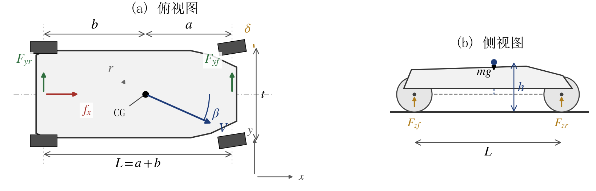

# drift-equilibrium

**Steady-state racing-car drift: equilibrium computation, fold continuation, design optimization and LQR stabilization**

课程大作业：定速、定前轮转角工况下赛车漂移平衡点的求解、多解/折叠分析、车辆参数设计与闭环镇定。
Nonlinear Optimization (2026 Fall) course project — everything is reproducible from the scripts in this repository.



## 这个仓库是什么

把赛车漂移当成一个**稳态非线性方程求根 + 分岔 + 约束优化 + 反馈控制**的问题来做：

- **建模**：三自由度单轨模型（β, r, f_x），刷子轮胎，后轴摩擦圆（驱动力挤占侧向能力），准静态载荷转移与气动力。
- **求解**：平衡方程 e(z; V, δ)=0 写成带箱约束的非线性最小二乘，实现 7 种算法（阻尼牛顿、差分牛顿、Gauss–Newton、Levenberg–Marquardt、信赖域 dogleg、BFGS、投影牛顿）并做同初值、同容差的定量对比。
- **拓扑**：多起点随机搜索 + 自然参数延拓 + 伪弧长延拓 + 扩展系统（平衡条件加 det J=0），把抓地叶、漂移叶和鞍结折叠点定位到机器精度。
- **设计**：以摩擦圆利用率 κ 为目标、抓地侧向加速度为约束，用隐函数定理把六维问题降到三维，再用增广拉格朗日（PHR）求解；KKT 乘子与影子价格互相验证。
- **控制**：对漂移平衡点线性化，解 CARE 得 LQR 增益，在非线性模型上做闭环仿真并统计吸引域。
- **验证**：另写一套程序（不 import 主模型）用 mpmath 50 位精度、SciPy、中心差分与主模型交叉校验，40 项全部通过。

## 关键结果

| 项目 | 数值 |
|---|---|
| 参考工况漂移平衡点（V=8 m/s, δ=0.10 rad） | β = −24.16°, r = 1.462 rad/s, f_x = 7816 N, κ = 0.740 |
| 折叠点（存在边界） | δ_f 由 1.015 rad（V=6 m/s）单调降到 0.356 rad（V=30 m/s） |
| 漂移平衡点稳定性 | 雅可比始终有一个正实部，开环不稳定（V=8 时 max Re λ ≈ 0.019 s⁻¹） |
| 设计优化 | κ 由 0.740 降到 0.518（−30%），约束侧向加速度 13.40 m/s² 保持，λ = 0.139 与影子价格一致 |
| LQR 闭环 | V=15 时 4.5 s、V=22 时 6.3 s 内把扰动收敛回平衡点 |
| 独立校验 | 40/40 项通过（解析雅可比 vs 中心差分 1.7e-10，mpmath 残差 4.4e-47） |

## 目录结构

```
.
├── race_drift_model.py       车辆模型：残差、解析雅可比、动力学、载荷/轮胎/稳定性诊断
├── race_drift_solver.py      求解器：7 种算法、多起点、自然/伪弧长延拓、折叠点、设计优化、LQR
├── verify_reference.py       独立校验：不 import 主模型，mpmath/SciPy/差分对照
├── build_figs.py             由 results.json 生成 12 张报告图（300 dpi）
├── race_drift_traj.py        世界坐标漂移轨迹（静态图 + GIF）
├── build_report.py           生成 Word 报告与数字自检（需本机 python-docx）
├── build_ppt.py              生成答辩 PPT（需 python-pptx）
├── interactive_drift.html    单文件离线交互演示（滑条、迭代动画、相平面、漂移轨迹）
├── results.json              全部数值实验结果（图/表的唯一数据源）
├── figs/                     图件（fig01–fig12、漂移轨迹 GIF、公式图片）
├── verify/                   独立校验报告与报告数字自检结果
├── references.md             参考文献与 BibTeX（15 条）
└── README.md
```

## 快速开始

```bash
python -m pip install numpy scipy matplotlib            # 核心依赖
python race_drift_solver.py --quick                     # 约 8 分钟，生成 results.json
python race_drift_solver.py                             # 完整版，约 21 分钟
python verify_reference.py                              # 独立校验，40 项
python build_figs.py                                    # 生成 figs/
python race_drift_traj.py                               # 漂移轨迹图 + GIF
```

`build_report.py` / `build_ppt.py` 需要 `python-docx`、`python-pptx`、`Pillow`，并且报告里的数字由 `verify/report_number_check.json` 自检（9 项）。报告与 PPT 成品不放在仓库里，运行脚本即可在本地重新生成。

交互演示直接双击 `interactive_drift.html`（纯内联 JS/Canvas，无外网依赖）；页面自带 4 个参考平衡点的残差与特征值自检。

## 方法要点

- **平衡方程**：`e(z) = [f_x + F_dx − F_yf sinδ + m r v_y, F_yf cosδ + F_yr + F_dy − m r v_x, a F_yf cosδ − b F_yr]`
- **轮胎**：`F_y = −M Φ(u)`，`u = C_α tanα / M`，`Φ(u)=sgn(u)(|u|−|u|²/3+|u|³/27)`（|u|≤3），否则 `sgn(u)`
- **后轴摩擦圆**：`M_r = sqrt(max(ε, (μ_r F_zr)² − f_x²))`
- **折叠检测**：延拓切向的 δ 分量变号后用扩展系统 `[e; det J/‖J‖³]=0` 精修
- **设计降维**：隐函数定理 `dz/dx = −J⁻¹ ∂e/∂x`，目标与约束梯度都用链式法则，和有限差分对照到 1e-9

## 引用与许可

代码以 MIT 许可开源，见 [LICENSE](LICENSE)。若用于课程报告或论文，可引用：

> Junhao Ye. *Equilibrium Computation, Stability Analysis and Design Optimization of Racing-Car Drifting Using Nonlinear Optimization*. Course project, Nonlinear Optimization, 2026.

模型与参数取自公开文献中的单轨/刷子轮胎与摩擦圆描述；参考文献见 [references.md](references.md)。
